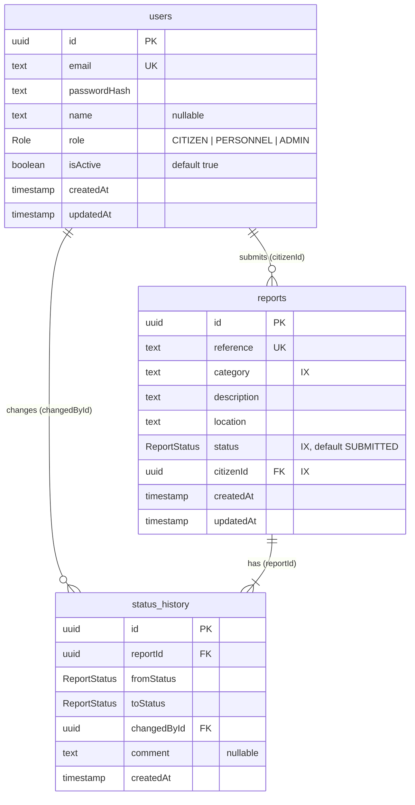

<!-- database-schema.md -->
# Database Schema Documentation

**Owner:** Dristen Venter (Person 2)
**Source of truth:** `apps/api/prisma/schema.prisma` and `apps/api/prisma/migrations/`. This document describes the schema as built; it continues PED v3.0 Appendix H. Proposed changes live in the Technical Debt Register (`docs/technical-debt/technical-debt-register.md`), not here.
**Engine:** PostgreSQL 18 via Prisma 6.19.3 (ADR-TECH-01 rev 1).
**Migrations at final baseline:** `20261006093524_init_m2_baseline` (the TD-04 and TD-05 fixes needed no schema change)
**Final baseline:** ⟨UPDATE: final tag / commit SHA⟩

## 1. Entity-relationship diagram



Every report has at least one `status_history` row, because the creation row is written in the same transaction as the report (§3).

## 2. Entities

| Table | Columns (NOT NULL unless stated) | Requirement trace |
|---|---|---|
| `users` | `id` (PK, uuid); `email` (unique); `passwordHash`; `name` (nullable); `role` enum `Role` = CITIZEN \| PERSONNEL \| ADMIN, default CITIZEN; `isActive` (default true); `createdAt`; `updatedAt` | FR-07, FR-08, FR-09, NFR-03 |
| `reports` | `id` (PK); `reference` (unique); `category` (indexed, text); `description`; `location`; `status` enum `ReportStatus` = SUBMITTED \| UNDER_REVIEW \| IN_PROGRESS \| RESOLVED, default SUBMITTED (indexed); `citizenId` (FK → users, indexed); `createdAt`; `updatedAt` | FR-01 to FR-06, NFR-05 |
| `status_history` | `id` (PK); `reportId` (FK → reports); `fromStatus`; `toStatus`; `changedById` (FK → users); `comment` (nullable, max 500 via API); `createdAt` | FR-05 audit trail |

Allowed categories (ROADS, WATER, ELECTRICITY, WASTE, PARKS, OTHER) and lengths (description 10–1000, location 5–255) are enforced by the API only (TD-10). Timestamps are stored in UTC.

**Reference format:** `CC-YYYYMMDD-XXXXXX`: UTC date plus 6 characters from a 32-symbol alphabet without 0/O/1/I (`report.reference.ts`, CR-013). It was `CC-YYYYMMDD-NNNN` (4 random digits) until TD-04 was repaid.

## 3. Constraints and indexes

| Constraint / index | Guarantee | PostgreSQL error when violated | API response |
|---|---|---|---|
| Primary keys on all three tables | Row identity | — | — |
| `users_email_key` (unique) | One account per email (FR-07) | 23505 | 409 on normal path; a registration race returns 500 (TD-06) |
| `reports_reference_key` (unique) | One reference identifies one report (FR-03) | 23505 | Retried with a new reference, up to 3 attempts (TD-04, INT-08) |
| `reports.citizenId → users` (RESTRICT) | No orphan reports; users with reports cannot be deleted | 23503 | — |
| `status_history.reportId → reports` (CASCADE) | No orphan history; deleting a report also deletes its history (TD-08) | — | No delete endpoint exists |
| `status_history.changedById → users` (RESTRICT) | Every audit row names a real user | 23503 | — |
| Indexes on `reports(status)`, `reports(category)`, `reports(citizenId)` | Staff filters and owner look-ups (FR-06, ASR-05) | — | — |
| NOT NULL on required columns | The FR-02 data set cannot be skipped at database level | 23502 | 400 is returned earlier by Zod |

Not yet indexed: `status_history(reportId)`, `status_history(changedById)`, `reports(createdAt)` (TD-09).

## 4. Transaction boundaries

| Use case | Inside one transaction | Guarantee / known gap |
|---|---|---|
| Submit report (`reportService.submitReport`) | Insert report + insert first history row | Both commit or neither (FR-01, FR-05). A reference collision rolls the transaction back and is retried with a new reference (TD-04) |
| Change status (`reportService.updateStatus`) | Read report → check transition (`canTransition`) → conditional status update → insert history row | No status change without an audit row; illegal transitions roll back and return 422 (ASR-02); a failed history insert rolls back the status change (INT-06). If another writer changed the status first, 0 rows update and the API returns 409 (TD-05, INT-05) |
| Register (`authService.register`) | Not a transaction (read, then insert) | The unique email index prevents duplicates; a race returns 500 (TD-06) |
| Authenticate (`middleware/auth.ts`) | Single read of `role` and `isActive` per request | Role changes and deactivation take effect on the next request (FR-09) |

**Why the status transaction is mandatory.** If the status update succeeded but the history insert failed (crash, lost connection, timeout), the citizen would see a new status with no record of who changed it or when, and the data alone could not repair it. The transaction makes PostgreSQL commit both writes or neither.

**Why the conditional update is also needed.** A transaction alone does not stop two staff members who both read `UNDER_REVIEW` from both writing `IN_PROGRESS`: each transaction is valid on its own at PostgreSQL's default READ COMMITTED isolation. Making the update conditional on the status that was read means the second writer changes 0 rows and is rejected (ADR-PERSISTENCE-01 rev 1).

Transactions use Prisma defaults (5 s timeout) and each holds one pool connection, so under load, pool exhaustion appears as Prisma timeout errors rather than slow responses.

## 5. Verification

Run on an isolated, migrated database (CI or staging) and save the output to `evidence/db/` with the commit hash.

```sql
-- 3 primary keys, 3 foreign keys, 2 unique constraints expected
SELECT conrelid::regclass, conname, pg_get_constraintdef(oid)
FROM pg_constraint WHERE connamespace = 'public'::regnamespace;

SELECT tablename, indexname FROM pg_indexes WHERE schemaname = 'public';

-- every report has its creation history row: expect 0 rows
SELECT r.reference FROM reports r
LEFT JOIN status_history h ON h."reportId" = r.id
WHERE h.id IS NULL;
```

```bash
npx prisma migrate status   # expect: database schema is up to date
```

Results: these queries were not run separately for the final baseline. The evidence that the schema is applied correctly is CI: every `quality-gate` run applies the migration to an empty PostgreSQL 18 database with `prisma migrate deploy`, and E2E-02, INT-05 and INT-06 read `reports` and `status_history` directly. Running the queries above on staging is listed as future work.

## 6. Migration rules

- CI and staging use only `prisma migrate deploy`; `migrate dev` is for local work.
- New migrations must be additive, or reviewed for rollback compatibility (PED v3.0 §4.5), because the application can be rolled back faster than the schema.
- Seed accounts (`prisma/seed.ts`) are for local and CI use only, never staging.
